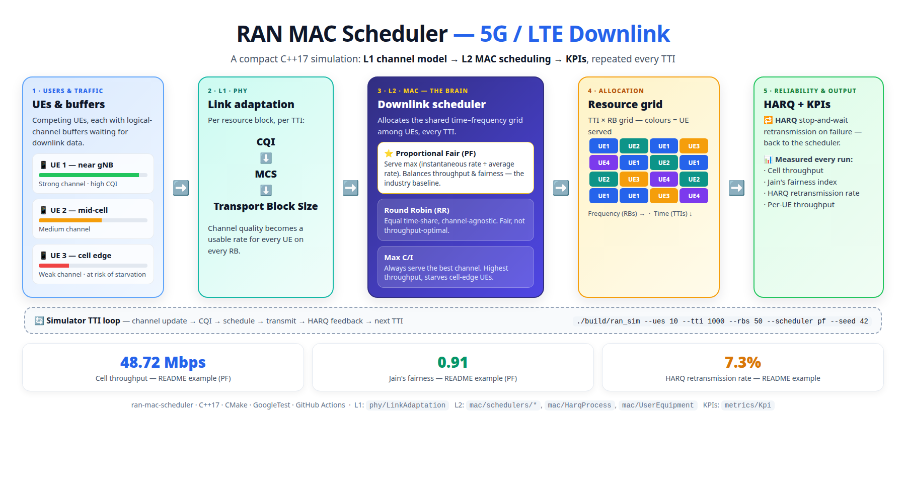

# ran-mac-scheduler

[](https://github.com/nerostamas/Radio-Access-Network-RAN-MAC-Scheduler/actions/workflows/ci.yml)
[](https://isocpp.org/)
[](LICENSE)

A compact, well-tested **C++17** simulation of a 5G/LTE **MAC-layer (L2) downlink scheduler**
running on top of a simplified **physical-layer (L1)** model. Built to demonstrate production-grade
C++, Radio Access Network (RAN) L1/L2 protocol knowledge, and a full CI/CD pipeline.

> **TL;DR** — Modern C++ · RAN L1/L2 protocol modeling · GoogleTest · CMake · GitHub Actions
> (build, test, sanitizers, clang-tidy, cppcheck, clang-format, coverage).

---

## Why this project

Radio Access Networks split the air interface into protocol layers. This project models the
boundary that matters most for throughput and fairness:

- **L1 (PHY):** channel quality (CQI) → modulation & coding scheme (MCS) → transport block size (TBS),
  per resource block (RB), per transmission time interval (TTI).
- **L2 (MAC):** how a base station (gNB/eNB) allocates a shared, time-and-frequency resource grid
  among competing user equipments (UEs) every TTI, with **HARQ** retransmissions for reliability.

The scheduler is the brain of L2. This repo implements three classic strategies and lets you
compare their throughput/fairness trade-offs on a reproducible channel model.

## RAN concepts modeled

| Concept | Layer | Where |
| --- | --- | --- |
| Resource Block (RB) grid, TTI loop | L1/L2 | `ResourceGrid`, `Simulator` |
| CQI → MCS → Transport Block Size | L1 | `phy/LinkAdaptation` |
| Per-UE logical channel buffers | L2 | `mac/UserEquipment` |
| Downlink scheduling (RR / PF / Max-C/I) | L2 (MAC) | `mac/schedulers/*` |
| HARQ stop-and-wait retransmission | L2 (MAC) | `mac/HarqProcess` |
| Throughput & Jain's fairness KPIs | — | `metrics/Kpi` |

## Schedulers

- **Round Robin (RR)** — equal time-share, channel-agnostic. Fair, not throughput-optimal.
- **Max C/I (Maximum Carrier-to-Interference)** — always serve the UE with the best channel.
  Highest cell throughput, starves cell-edge UEs.
- **Proportional Fair (PF)** — serve the UE maximizing instantaneous-rate / average-rate.
  Balances throughput and fairness; the de-facto industry baseline.

---



---

## Build

Requirements: a C++17 compiler (GCC 9+/Clang 10+) and CMake 3.16+.

```bash
cmake -S . -B build -DCMAKE_BUILD_TYPE=Release
cmake --build build -j
```

## Run

```bash
./build/ran_sim --ues 10 --tti 1000 --rbs 50 --scheduler pf --seed 42
```

Example output:

```
Scheduler: ProportionalFair | UEs: 10 | RBs: 50 | TTIs: 1000
------------------------------------------------------------
Cell throughput : 48.72 Mbps
Jain's fairness : 0.91
HARQ retx rate  : 7.3 %
Per-UE throughput (Mbps): 5.1 4.8 5.3 4.6 ...
```

## Test

```bash
ctest --test-dir build --output-on-failure
```

## Developer tooling

```bash
# Format check
clang-format --dry-run --Werror src/**/*.cpp include/**/*.hpp

# Static analysis
clang-tidy -p build src/**/*.cpp
cppcheck --enable=all --std=c++17 src include

# Sanitizers
cmake -S . -B build-asan -DCMAKE_BUILD_TYPE=Debug -DENABLE_SANITIZERS=ON
cmake --build build-asan -j && ctest --test-dir build-asan
```

## CI/CD

Every push and pull request runs the GitHub Actions pipeline in `.github/workflows/ci.yml`:

1. **Lint** — `clang-format` style check.
2. **Build matrix** — GCC and Clang, Debug + Release.
3. **Test** — GoogleTest via CTest.
4. **Static analysis** — `clang-tidy` and `cppcheck`.
5. **Sanitizers** — AddressSanitizer + UndefinedBehaviorSanitizer test run.
6. **Coverage** — `gcov`/`lcov` summary.

## Project layout

```
ran-mac-scheduler/
├── CMakeLists.txt
├── include/ran/           # public headers
│   ├── phy/               # L1: link adaptation (CQI/MCS/TBS)
│   ├── mac/               # L2: UE, HARQ, schedulers, resource grid
│   └── metrics/           # KPIs
├── src/                   # implementations + CLI (main.cpp)
├── tests/                 # GoogleTest unit tests
├── .github/workflows/     # CI/CD
├── .clang-format
├── .clang-tidy
└── README.md
```

## License

MIT © Nguyen Phuc Tran
